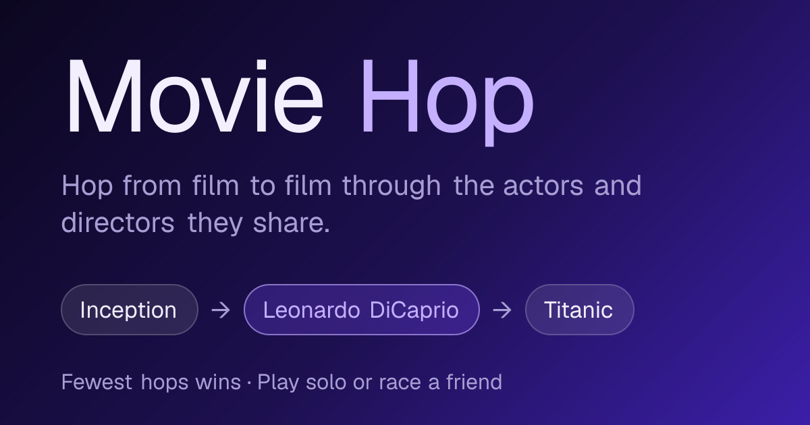
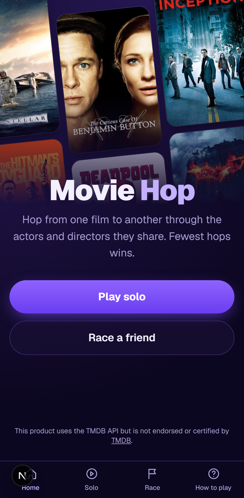
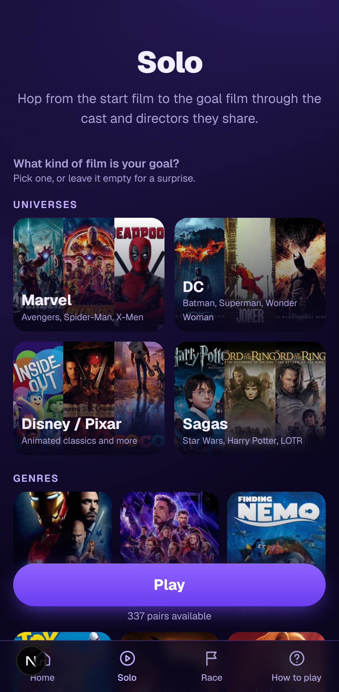
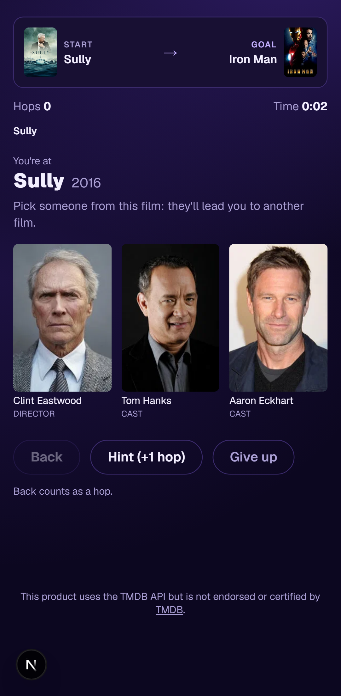
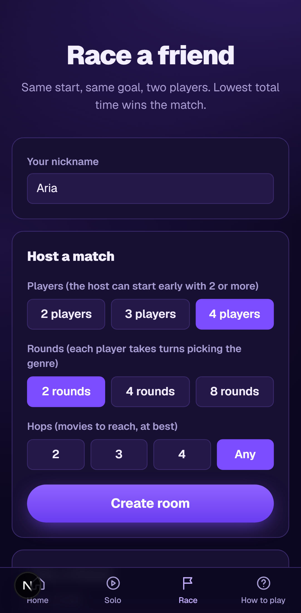
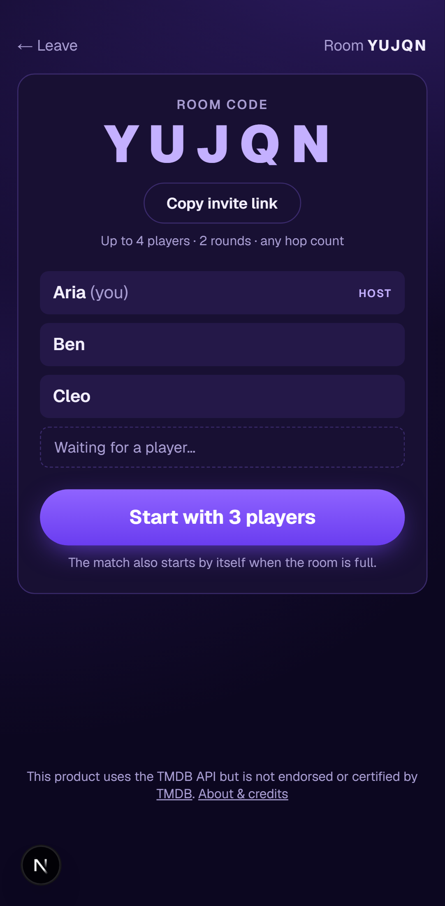
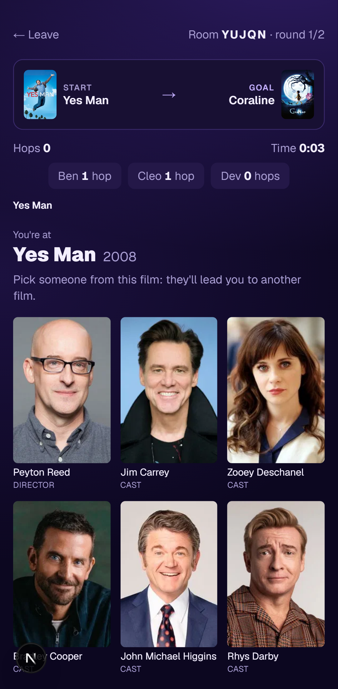
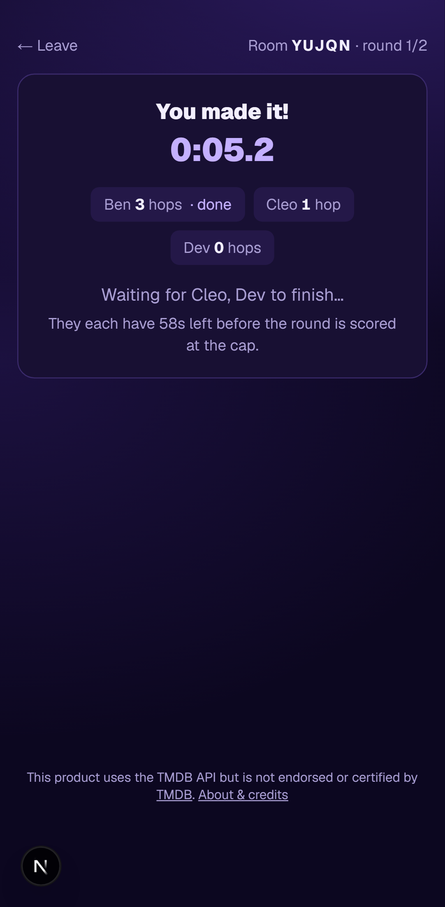
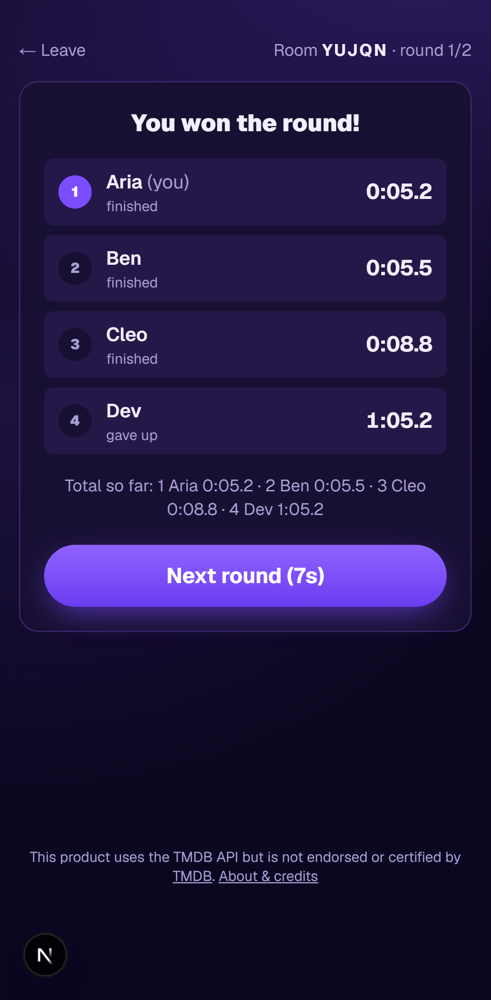
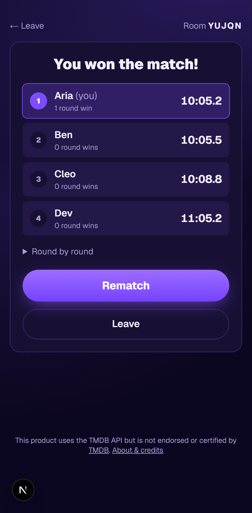

<div align="center">

# 🎬 Movie Hop

**Hop from one film to another through the actors and directors they share. Fewest hops wins.**

Built for movie nerds, by a movie nerd.

[**▶ Play it live**](https://movie-hop.vercel.app/) · [How it works](#how-it-works) · [Race mode](#race-mode-24-players) · [Run it yourself](#run-it-yourself)




</div>

---

## The game in 10 seconds

You get a **start film** and a **goal film**. Get from one to the other by hopping:

```
Film A  →  an actor or director from A  →  Film B  →  someone from B  →  …  →  Goal film
```

Every hop goes **film → someone from its cast or its director → another film they worked on**.
Fewer hops is better. Going *Back* counts as a hop, so think before you click. Stuck? Take a
**hint** (once per run), but it costs you.

Pick the **genre of the goal film** (Action, Horror, Sci-Fi…) or a whole universe: **Marvel, DC,
Disney / Pixar, Sagas** (Star Wars, Harry Potter, LOTR). Pick how many hops you want, or leave it open.

## Screenshots

### Solo

| Home | Pick a goal | Playing |
|:---:|:---:|:---:|
|  |  |  |
| Play solo or race friends | Genres and universes as poster tiles | Choose a person, then one of their films |

### Race with up to 4 friends

| Create a room | Lobby | Race board |
|:---:|:---:|:---:|
|  |  |  |
| 2–4 players, 2/4/8 rounds | Share the code or invite link | Everyone's hop count, live |

| Finished, watching | Round results | Final standings |
|:---:|:---:|:---:|
|  |  |  |
| See who's done while you wait | Ranked fastest first | Lowest total time wins |

## How it works

### The data: a film ↔ person graph, shipped as static files

There are **no API calls while you play**. Everything is precomputed once from [TMDB](https://www.themoviedb.org/):

- `data/graph.json`: films linked to their top-billed cast and director (famous connectors only, so
  every hop makes sense to a human).
- `data/pairs.json`: **530 start/goal pairs**, each with its goal genre or universe tag, its
  shortest hop count (2, 3 or 4) and sample shortest routes (used for the hint and the result screen).

The precompute script (`precompute_credit_pairs.mjs`) builds the graph, tags the Marvel / DC /
Disney / saga films, searches for real shortest paths, and keeps only pairs that have a good,
famous route. Clicks are instant, there are no rate limits, and the TMDB key never ships to the browser.

### Solo

A small reducer (`lib/game.ts`) holds the path, the people you went through, the hop count and the
win state. Choosing a person is free; choosing one of their films is a hop. Reaching the goal film
ends the run and shows your route. The hint (`lib/hint.ts`) points toward a connector on a shortest
route without handing you the answer, and costs an extra hop.

### Race mode (2–4 players)

```
 browser ──RPC──▶ Supabase Postgres functions (SECURITY DEFINER, row locks, server clock)
    ▲                        │
    └── realtime changes ◀───┘   (polling as a safety net)
```

- **Anonymous players**: a nickname, no accounts. Supabase anonymous auth gives each browser an identity.
- **The database is the referee.** Clients can only *read* their own room. Every write (join, ready,
  progress, finish, give up…) goes through a Postgres function that locks the room and uses the
  **server clock**, so nobody can cheat by changing their phone's time.
- **Flow:** lobby (the host starts, or it starts by itself when full) → the round's picker chooses
  the goal genre → everyone presses ready → **4 second countdown** → race.
- **Scoring:** total time across rounds, lowest wins. A hint adds **15 s**. After the first finisher
  the others get **60 s**. Giving up, timing out or leaving is scored at the cap (first finisher's
  time + 60 s, or 10 min if nobody finished) and the others carry on.
- **Rotation:** the player who picks the goal rotates by seat each round. A rematch needs everyone.
- **Free-tier friendly:** realtime is only opened while a match is moving; lobbies and results poll
  gently instead, so a room costs few connections. Old rooms are cleaned up automatically (`pg_cron`)
  and each player can create 10 rooms per hour.

### Quality

- **Unit tests** (Vitest): game reducer, race rules for 2–4 players, scoring, polling rules, graph integrity.
- **Database tests**: the real Supabase functions, including 3 and 4 player matches.
- **End-to-end tests** (Playwright): solo, picker, mobile widths, link-preview meta, and real
  2-, 3- and 4-window races against Supabase.
- **Accessibility:** axe scans (WCAG A/AA) on every screen, skip link, keyboard-friendly, screen-reader labels.

## Run it yourself

```bash
npm install
cp .env.example .env.local      # then fill in the values below
npm run dev                     # http://localhost:3000
```

| Variable | Needed for | Public? |
|---|---|---|
| `NEXT_PUBLIC_SUPABASE_URL` | the race (project URL, no path) | yes |
| `NEXT_PUBLIC_SUPABASE_ANON_KEY` | the race (publishable / anon key) | yes (protected by row level security) |
| `TMDB_KEY` | only `node precompute_credit_pairs.mjs` | **no**: never expose it |

Solo play works with no settings at all.

### Set up the race (Supabase)

1. Create a Supabase project and switch on **Authentication → Sign In / Providers → Allow anonymous sign-ins**.
2. In the **SQL Editor**, run these once, in order:
   `supabase/migrations/0001_race.sql`, `0002_race_hardening.sql`, `0003_players_2_to_4.sql`.
3. Put the project URL and anon key in `.env.local` (and in your host's environment variables).

### Tests

```bash
npm run lint
npm run typecheck
npm test            # unit tests
npm run test:e2e    # Playwright (builds and serves the app; race tests need Supabase settings)
npm run test:db     # database function tests against your real Supabase project
```

Run the browser tests against a deployed site with `E2E_BASE_URL=https://movie-hop.vercel.app npm run test:e2e`.

### Regenerate the game data

```bash
node precompute_credit_pairs.mjs                                  # reads TMDB_KEY from .env.local
DISCOVER_PAGES=120 PER_CELL=10 node precompute_credit_pairs.mjs   # bigger film set, more pairs
```

### Deploy

Import the repo into Vercel (Next.js is detected automatically) and set the two `NEXT_PUBLIC_SUPABASE_*`
variables. `TMDB_KEY` is not needed there.

## Project layout

```
app/          routes: home, solo, race, race/[code], how-to-play, about, icons and link previews
components/   Game, poster tiles, picker, result panel, race/ (room, lobby, panels, useRoom hook)
lib/          game reducer, graph + pairs loaders, hint, race rules (pure, unit tested), Supabase client
data/         graph.json and pairs.json (generated, static)
supabase/     SQL migrations for the race
tests/ e2e/   Vitest unit + DB tests, Playwright end-to-end tests
docs/         README screenshots
```

## Credits

Film and cast data and images from [TMDB](https://www.themoviedb.org/). This product uses the TMDB API
but is not endorsed or certified by TMDB. TMDB's free API and Vercel's free Hobby plan are for
non-commercial use.
